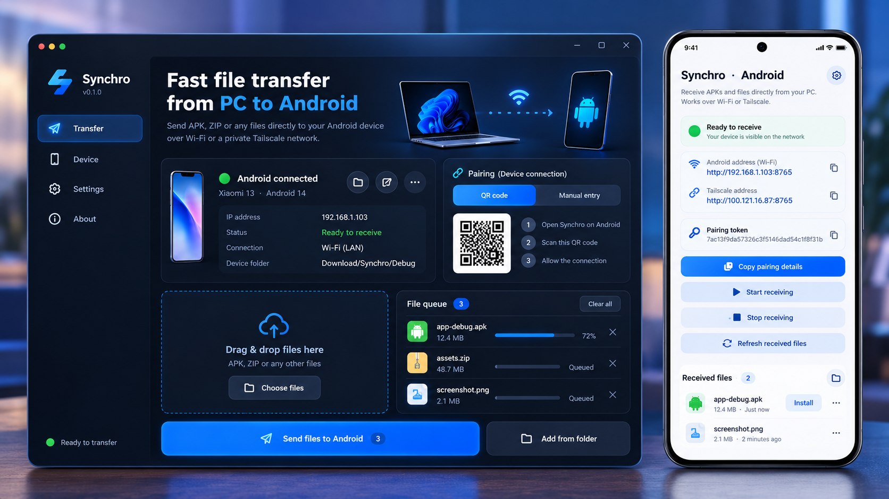

# Synchro · Rust → Android

**Drop a freshly built APK on your Windows PC; receive it directly on Android without Viber, archives, or cloud uploads.**

Synchro is an experimental open-source PC-to-phone file transfer utility. The Windows/Linux sender is **Rust + egui** and the Android 10+ receiver is **native Kotlin**.

## What Synchro currently contains

- Drag and drop APKs, ZIPs or other files into the Rust desktop window.
- Configure phone address and secret token once; settings saved in your user's config directory.
- Send each file directly over trusted Wi-Fi or a private Tailscale network.
- Stream uploads to **Download/Synchro/Debug/**, verifying SHA-256 before exposing the file.
- Tap **Install APK** on Android to open the system installer. This requires Android confirmation.

**Status: Synchro v0.3 source update is in `main`. The refreshed Windows and Android versions still require a local compile and real-device transfer test.** There are no verified prebuilt release EXE/APK artifacts.

## Затверджений дизайн / Approved design reference



**Це цільовий макет Synchro для Windows і Android.** Вся наступна робота над інтерфейсом орієнтується на цю картинку. Дивись [дизайн-специфікацію та критерії готовності](docs/design/README.md).

> The picture is a design target (mockup), not a screenshot of currently implemented features. Only show live connection status, transfer progress and device details after verifying real data.

## v0.3.1 Stability Update

The fixes from the [v0.3 bug audit](docs/AUDIT-0.3-2026-10-19.md) have been implemented in source. **[Read the v0.3.1 fix list and regression tests](docs/RELEASE-0.3.1.md).** These changes have not yet been compiled and validated on your local Windows/Android devices.

- Queue restored after restart, saved with backup, automatically drained when new files arrive during upload.
- Per-path progress and build-change detection protect multiple same-named APK outputs.
- Safer APK-only folder watcher with stable-file delay.
- Android supports health checks during a file upload, bounded clients, stricter deadlines, MediaStore cleanup and true Downloads storage checks.
- APK installer permission state and user-visible last transfer errors are improved.

Run from the repository root: `.\scripts\verify-local.ps1 -Android` (requires Rust + Android SDK + JDK). Pair and send a test file before relying on automation.

## Synchro v0.3: велике оновлення

**[Changelog, test plan and known limitations](docs/RELEASE-0.3.md)** · [Approved design](docs/design/README.md)

- **Windows:** actual Android identity, periodic connection test, progress in the file queue, recent successful transfers, stable-output-folder watcher, private-network receiver validation.
- **Android:** card-based light layout, true receiver state, copied IP/token, list of files received, APK install permission handling, branded icon and health metadata.
- **Android Studio Emulator:** `scripts/connect-emulator.ps1` forwards port 8765; use `http://127.0.0.1:8765` on Windows.
- **Important:** QR pairing from the picture is an agreed future milestone, not a working feature yet.

From the repository root, run:

```powershell
git pull --ff-only
cd desktop
cargo test
cargo check
cargo run --release
```

Build and test Android separately:

```powershell
cd M:\projects\synchro
.\scripts\build-android.ps1
.\scripts\connect-emulator.ps1
```

## Modern desktop UI (v0.2)

The desktop now uses a custom dark sidebar with **Передача / Пристрій / Налаштування / Про програму**, editable Android pairing, a native multi-file picker, drag-and-drop, a persistent pending queue, transfer progress and a real **Перевірити** connection test. The connectivity check calls authenticated `GET /health`, so **both** the Windows app and Android receiver must be updated to v0.2 for the green "Android онлайн" state.

QR pairing and automatically detected device names are **not** included yet: these controls are intentionally not simulated. Use the phone's actual IP address and 32-character pairing token.

**After pulling the new code**, build both programs again, keeping Android's receiver open:

```powershell
cd M:\projects\synchro
git pull --ff-only
cd desktop
cargo check
cargo run --release
```

Build the corresponding new Android APK in Android Studio or using `android\gradlew.bat assembleDebug`. This is a source change and **has not been compile-tested on Windows** in this environment.

## Android JDK detection and Gradle 8.13

Gradle 8.13 requires a compatible runtime; Java 8 and Java 25 cannot run it. PowerShell's `java -version` may report Java 8 from PATH even when Android Studio's Gradle JDK is different.

From the repository root, use:

```powershell
cd M:\projects\synchro
git pull --ff-only
.\scripts\build-android.ps1
```

The script searches JAVA_HOME, Android Studio's bundled JBR, `%USERPROFILE%\.jdks`, `%USERPROFILE%\.gradle\jdks`, AndoCart's toolchains, and several common JDK installation directories. It selects an installed Java 17–23 runtime and temporarily sets JAVA_HOME for the build only.

**If no compatible JDK is found:** In Android Studio > Settings > Build Tools > Gradle, inspect the full path of the selected Gradle JDK (for instance, JBR 21). Pass that directory explicitly:

```powershell
.\scripts\build-android.ps1 -JdkHome "C:\full\path\to\jbr-21"
```

Alternatively, install an independent JDK 17 using `winget install --exact --id EclipseAdoptium.Temurin.17.JDK` and restart PowerShell. The script never downloads or installs a JDK without your consent.

Successful builds produce `android\app\build\outputs\apk\debug\app-debug.apk`.

## Running the desktop sender on Windows

Requirements: updated Rust stable (edition 2024) and C++ build tools for the Windows MSVC toolchain.

```powershell
git clone https://github.com/kabasik007/synchro.git
cd synchro\desktop
cargo test
cargo run --release
```

Or from repository root, use `scripts/build-windows.ps1`. The executable builds at `desktop/target/release/synchro-desktop.exe`.

## Building Android receiver

Requirements: Android Studio, SDK 36, JDK 17, Android Gradle Plugin 8.13.2, Gradle **8.13** (not Gradle 9.x), Kotlin 2.3.0.

1. Open the repository's `android` directory in Android Studio.
2. In **Settings → Build, Execution, Deployment → Build Tools → Gradle**, choose **Gradle Wrapper** (the project's `gradle-wrapper.properties`, not the local Gradle 9.6 installation). Set **Gradle JDK** to JDK 17.
3. Sync Gradle. The repository pins Gradle 8.13. The Windows `gradlew.bat` downloads the official Gradle 8.13 Wrapper JAR from Gradle's [v8.13.0 GitHub source tag](https://github.com/gradle/gradle/blob/v8.13.0/gradle/wrapper/gradle-wrapper.jar) (with GitHub API fallback), then verifies its SHA-256 against the [Gradle 8.13 release checksum](https://gradle.org/release-checksums/) on first run. The normal Gradle distribution ZIP is then downloaded by the verified wrapper.
4. Run **Build → Build APK(s)**, or use the following from PowerShell:

```powershell
cd synchro\android
.\gradlew.bat --version
.\gradlew.bat assembleDebug
```

5. Install `android/app/build/outputs/apk/debug/app-debug.apk` on a physical Android 10+ device.

The local debug APK is automatically debug-signed by Android tooling, and is not a production-signed release.

## Pair devices and send

1. Open the Android app and tap **Start receiving**.
2. Find the Wi-Fi address shown in the app, e.g. `http://192.168.1.25:8765`, and the 32-character pairing token.
3. Enter the address and token in Synchro Desktop. Drop one or more files into the window.
4. Transfers start automatically when pairing is configured. The files appear in Android's `Download/Synchro/Debug/`.
5. In Synchro Android, choose **Install APK** for an APK or **Open file** for another type.

Android asks for explicit approval before an APK can be installed; it may also require granting **Install unknown apps → Synchro** once. Ordinary third-party Android apps cannot silently install APKs.

## Developer shortcut: direct ADB installation

If your Android phone is already authorized for USB or wireless debugging, simply drag your signed APK onto `scripts/drop-apk-to-install.cmd` in Windows Explorer. The helper invokes `adb install -r` using Android SDK Platform Tools. In this mode, neither the Android receiver app nor transfer configuration is required. Use this only for your own development devices.

## Over the Internet — without your own server

Install [Tailscale](https://tailscale.com/) on Windows and Android, connect both devices to your private tailnet, and use the phone's `100.x.y.z` address as `http://100.x.y.z:8765` in Synchro Desktop. Connections are secured by Tailscale, which may relay traffic when a direct path is not possible.

A custom server, aaPanel, port forwarding, and Cloudflare Tunnel are **not necessary** for this mode. Both devices must be online; the Android receiving service must be started.

**Security:** Never port-forward port 8765 from the public internet. Plain HTTP on a local network is authenticated but not encrypted; use trusted Wi-Fi or an encrypted private network.

## How it works

```text
Windows: Rust + egui           Android: Kotlin receiver
  APK / ZIP drop                   foreground receiver
       |                                   |
  SHA-256 → HTTP POST  ─────────► token validation
     Wi-Fi/Tailscale                 streaming + SHA-256
                                            |
                                  Download/Synchro/Debug
                                            |
                                    Tap Install APK
                                            |
                                    Android system installer
```

See [transfer protocol](docs/PROTOCOL.md) and [roadmap](docs/ROADMAP.md).

## License

MIT · see [LICENSE](LICENSE).
